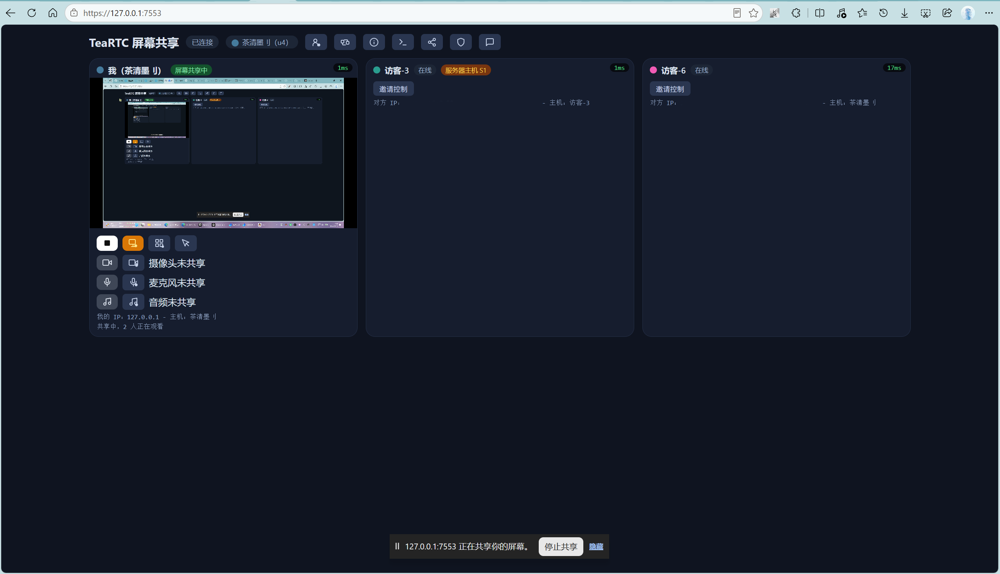

# TeaRTC 屏幕共享

多人实时屏幕共享与远程控制工具。共享端无需安装任何客户端，观看端只需一个浏览器，打开网址即可加入观看。

## 功能特性

- **屏幕 / 摄像头共享**：一键共享整个屏幕或摄像头画面
- **浏览器即看**：观看端无需安装，电脑 / 手机浏览器打开网址即可实时观看
- **多人同时观看**：不限观看人数，低延迟画面（自动选择最佳编码与清晰度，iOS / Android 手机均兼容）
- **远程控制**：观看者可申请控制权，共享者一键授权；也可主动邀请对方控制（鼠标 + 键盘）
- **内置文字聊天**：观看时边看边聊
- **事件提示音**：加入 / 断线 / 控制请求等均有提示（可关闭）
- **多显示器支持**：可共享副屏内容
- **系统托盘**：后台运行、静默启动、托盘一键打开页面
- **日志查看**：页面内实时查看运行日志，另有本地文件留存
- **版本更新检查**：页面自动检查 GitHub 最新版本（网络不通时静默），发现新版本可一键跳转 GitHub / 网盘下载
- **绿色单文件**：免安装，一个 exe 直接运行

## 使用场景

- 临时演示、教学同屏：把屏幕实时共享给教室里的所有设备
- 远程协助：让对方申请控制你的电脑，直接帮你操作
- 家庭 / 小团队协同：边看画面边文字沟通

## 快速开始（Windows）

1. 下载 `TeaRTCShare.zip`（见下方「获取方式」）
2. 解压后双击运行 `TeaRTCShare.exe`，按系统提示允许防火墙访问（端口 7553）
3. 浏览器打开提示的地址（本机为 `https://localhost:7553`）并信任自签证书
4. 点击「共享屏幕」或「共享摄像头」

**观看者**：在浏览器中输入共享者的地址（例如 `https://192.168.1.100:7553`），即可加入观看。

> 提示：同一局域网内直接用本机地址访问；跨网络访问请确保端口 7553 已放行，或使用支持 IPv6 的网络（软件内置网络检测，可在「关于」中查看主机网络状态）。

## IPv6 使用说明

跨网络访问时建议使用 IPv6（无需公网 IP / 端口映射）。IPv6 是**端到端**的——共享者和观看者**双方都需开启 IPv6** 才能连接。

### 如何检测
- **软件内**：打开页面 →「关于」→「主机网络检测」，查看：
  - **主机 IPv6 地址**：本机是否获得全局 IPv6 地址（2408/2409/240e 开头等）
  - **主机 IPv6 出站**：能否访问 IPv6 网络
  - **主机公网 IPv6 / IPv4**：外网是否可达
- **检测网站**：打开 <https://testipv6.cn/> 或 <https://www.bj-ipv6.com/z/> 一键检测本机 IPv6 是否可用

### 场景一：主机没有 IPv6（关于弹窗显示"无"）
需要**共享者（运行服务的一方）**开启 IPv6：
1. 按 `Win + R`，输入 `powershell` 回车
2. 右键粘贴命令，回车：`Enable-NetAdapterBinding -Name "*" -ComponentID ms_tcpip6`（需管理员运行；多数系统默认已启用，此命令仅在禁用时生效）
3. 重新打开 <https://testipv6.cn/> 确认检测通过

### 场景二：主机有 IPv6，但对方进不来
需要**观看者**开启 IPv6（IPv6 端到端，双方缺一不可）：
1. 同样在电脑上运行：`Enable-NetAdapterBinding -Name "*" -ComponentID ms_tcpip6`（管理员），或确认已启用
2. 手机端：手机流量一般默认支持；使用 WiFi 时需在路由器设置中开启 IPv6
3. 用浏览器打开 `https://[IPv6地址]:7553` 访问（IPv6 地址需加方括号）

> 提示：共享者在「关于」弹窗点击「复制提示给浏览端」，可直接复制完整提示（含地址、开启命令、检测链接）发给对方。

## 公网穿透访问（固定域名）

不想让观看者每次重新输入新的 IPv6 地址？使用内网穿透可获得**固定 HTTPS 域名**，浏览器打开即用（服务商自动签发可信证书，无需安装 CA）。软件内：打开页面 →「关于」→「公网穿透教程」可随时查看。

### 为什么用穿透
- 直连 IPv6：每次换网络/地址都要重新发给观看者，且对方必须开启 IPv6
- 穿透：固定 HTTPS 域名，观看者打开即用

### 可选工具（均提供公网访问域名）
- **樱花穿透 SakuraFrp**：国内服务，免费二级域名（如 `xxx.natfrp.com`）；创建隧道时勾选「可建站」节点；支持绑定自己的域名（自购域名 + CNAME 解析，国内节点需备案），自定义域名支持**自动 HTTPS**——隧道类型选 TCP，在樱花面板开启自动 HTTPS，证书自动签发续期，无需自己配置
- **ngrok**：免费注册，临时域名（付费固定域名），HTTPS 自动
- **Cloudflare Tunnel**（cloudflared）：免费，可绑定自己的域名，HTTPS 自动
- **Tailscale Funnel**：免费版自带固定 `*.ts.net` 域名，HTTPS 自动

### 通用步骤
1. 注册账号，在服务器安装客户端
2. 创建隧道：协议 HTTPS，目标地址 `127.0.0.1:7553`
3. 启动后获得 `https://xxx` 公网域名
4. 把域名发给观看者，浏览器直接打开即可（首次访问若提示证书，点「继续前往」）

> 注意：穿透服务有流量与带宽限制，人多/高画质会卡，适合备用入口；服务器需保持运行；国外工具在国内访问可能不稳定，可自行选择可用工具。

> 提示：通过穿透域名打开页面时，软件会检测并提示「穿透访问」，可一键切换到直连地址（不消耗穿透流量）。

## 使用指南

| 操作 | 方法 |
| --- | --- |
| 共享屏幕 / 摄像头 | 打开页面 → 点击「共享屏幕」/「共享摄像头」 |
| 停止共享 | 点击页面上的「停止共享」 |
| 申请控制 | 观看者点击画面上的「申请控制」→ 共享者确认后即可控制（鼠标 + 键盘） |
| 邀请控制 | 共享者在我的卡片上点击「邀请」→ 对方同意后获得控制权 |
| 收回控制权 | 共享者随时点击「收回控制」 |
| 聊天 | 打开页面右侧聊天面板输入即可 |
| 提示音开关 | 点击「关于」→ 切换「声音提示」 |
| 查看日志 | 点击页面顶部「日志」按钮，实时查看；日志文件保存在程序目录 `logs/` 下 |
| 检查更新 | 页面加载后自动检查；也可在「关于」→「检查更新」手动查看，新版本可在 GitHub / 网盘下载 |

## 安全与隐私

- 画面通过加密通道传输（HTTPS + WebRTC 加密），**画面只经过你与观看者自己的设备，不经过任何第三方服务器**
- 连接使用自签证书，浏览器会提示「不安全」——这是正常现象，选择「继续访问」即可（详见常见问题）
- 本地无遥测、无广告，日志仅保存在本机

## 系统要求与浏览器支持

- 运行端：Windows 10 / 11（绿色单文件，无需安装）
- 观看端：Chrome / Edge / Firefox / Safari（电脑与手机均可）

## 常见问题

**Q：浏览器提示证书「不安全」，怎么继续？**
这是自签证书的正常提示。Chrome / Edge：点击「高级」→「继续前往」；手机浏览器同理。仅首次访问需要。

**Q：防火墙提示是否允许访问？**
请选择「允许」（TCP/UDP 端口 7553），否则他人无法连接。程序启动时会自动尝试配置完整防火墙规则（含 TURN 与程序放行）；若未生效，以管理员身份运行程序一次即可（规则永久生效）。

**Q：手机上看不到画面 / 摄像头黑屏？**
建议使用较新版本的 Chrome 或 Edge 浏览器（iOS 使用 Edge 体验更佳）；摄像头兼容问题会自动适配，请确保已允许浏览器使用摄像头。

**Q：手机没有提示音？**
在页面上点一下屏幕完成首次交互后，提示音即会启用。

**Q：静默启动（后台运行）后，日志怎么看？**
日志仍会写入程序目录 `logs/` 下的日志文件；也可以在浏览器打开页面 → 「日志」按钮查看。

**Q：可以控制副屏吗？**
可共享副屏画面，但远程控制目前仅支持主屏。

## 获取方式

提供两种版本，任选其一（约 18 MB / 安装包约 10 MB）：

- **蓝奏云下载**：[点击进入](https://wwaul.lanzout.com/b00g4f9iva)，访问密码 `TeaTea`
- **123 云盘下载**：[点击进入](https://1818650178.share.123pan.cn/123pan/gjihjv-9vTwd)
- **夸克网盘下载**：[点击进入](https://pan.quark.cn/s/0fc6a68aea08)
- **GitHub 仓库资源页面**：[Releases](https://github.com/TeaClearInkII/TeaRTC-Share/releases)

- **绿色版 `TeaRTCShare.zip`**：免安装，解压后直接双击 `TeaRTCShare.exe` 运行
- **安装包 `TeaRTCShare-Setup.exe`**：安装向导全中文，自动创建开始菜单快捷方式（可勾选桌面快捷方式）、预置防火墙规则（TCP/UDP 7553、TURN 3478、程序全端口放行）、支持控制面板卸载

熟悉 Go 的用户亦可从源码自行构建：`go build -o TeaRTCShare.exe .`

## 致谢

基于以下开源项目构建：[Pion WebRTC](https://github.com/pion/webrtc)、[gorilla/websocket](https://github.com/gorilla/websocket)、[systray](https://github.com/getlantern/systray)、[go-winres](https://github.com/tc-hib/go-winres)

## 许可证

本项目使用 [GPL v3](LICENSE) 许可证（GNU General Public License v3.0）。
